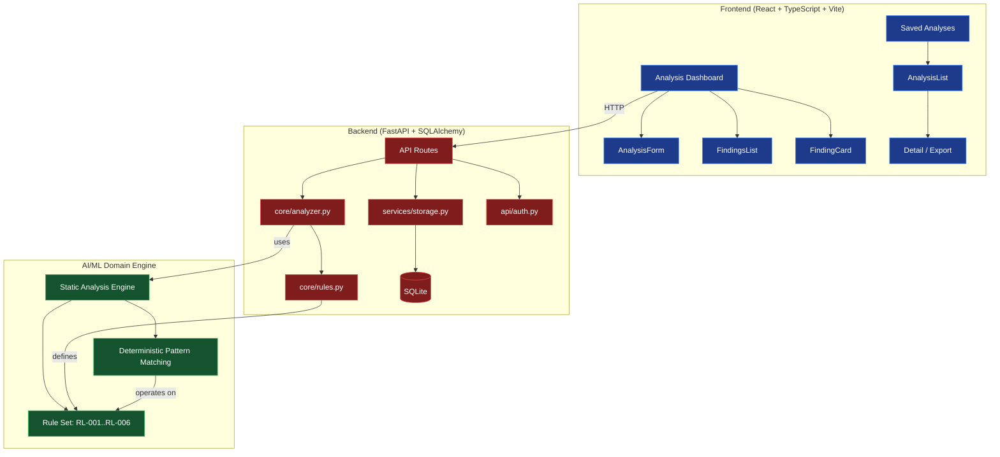

# Sentinel Forge | Alan Vo | AI & Machine Learning

> Work in progress. This checkpoint may be incomplete or fail tests. See PLAN.md and STATUS.md before use.


**Evaluating the safety and correctness of Claude Code mods (function hooks) through deterministic static analysis.**

Sentinel Forge addresses the growing need for **plugin safety evaluation** in the Claude Code extensibility ecosystem. As developers compose mods (TypeScript/JavaScript function hooks) that intercept agent events — terminal redraws, command execution, network calls, file mutations — subtle side-effect declarations, accessibility regressions, and missing error handling can introduce runtime failures or security exposure before a single agent session runs.

The implemented approach is a **deterministic, offline static analyzer** that scans mod source code line-by-line against a rule set of common pitfalls (unsafe process execution, untracked file writes, network calls without timeouts, full-screen terminal redraws, unbounded loops, missing error handlers). An optional LLM explanation layer — not implemented in this round — can provide advisory context grounded in the actual findings.

**Intended users:** Claude Code mod authors, AI safety reviewers, and agentic-coding platform operators who deploy or evaluate custom function hooks.

## Quick Start

```bash
# Backend
python3 -m venv .venv
.venv/bin/pip install -r backend/requirements.txt
PYTHONPATH=backend .venv/bin/python -m pytest backend/tests -v

# Frontend
cd frontend
npm install
npm test
npm run build
```

Or with Docker Compose:

```bash
docker compose up --build
```

UI: http://127.0.0.1:8080 · API: http://127.0.0.1:8000 · Health: http://127.0.0.1:8000/health

## Architecture



## Features

### Mod Safety Analyzer (Round 1 — implemented)

Submit TypeScript or JavaScript mod source code and receive a prioritized list of findings with line/column locations, messages, and fix suggestions. All analysis runs **offline with no LLM key required**.

| Rule ID | Name | Severity | Description |
|---------|------|----------|-------------|
| RL-001 | Unsafe Process Execution | Critical | `child_process.exec/spawn` without side-effect tracking |
| RL-002 | Unsafe File System Write | Warning | `fs.writeFile/unlink` without error handling |
| RL-003 | Unsafe Network Call | Warning | `fetch()` / `http.request` without timeout |
| RL-004 | UI Flickering Pattern | Info | Full-screen redraws (accessibility, issue #769) |
| RL-005 | Unbounded Loop | Warning | `while(true)`, `setInterval` without exit |
| RL-006 | Missing Error Handler | Warning | Async calls without `.catch()` or try/catch |

**Three complete workflows:**

1. **Analyze** — Paste mod code → get instant findings with severity-sorted list.
2. **Save & Browse** — Persist analysis results to SQLite → browse saved analyses with pagination and filtering.
3. **Detail & Export** — View full saved analysis → export as JSON.

### Planned (future rounds)

- **Usage Pattern Tracker** — Predict Claude Code subscription limit exhaustion from historical consumption data.
- **Mod Evaluation Harness** — Simulate agent events and evaluate mod side-effect declarations against registered declarations.
- **OIDC Authentication with Keycloak** — Full SSO with SAML identity brokering.
- **Multi-Provider LLM Adapter** — Opt-in LLM explanations grounded in actual findings.

## API Reference

| Method | Path | Auth | Description |
|--------|------|------|-------------|
| `GET` | `/health` | None | Health check |
| `POST` | `/api/v1/analyze` | None | Analyze mod source code |
| `GET` | `/api/v1/rules` | None | List analysis rules |
| `POST` | `/api/v1/analyses` | Required | Save an analysis result |
| `GET` | `/api/v1/analyses` | Required | List saved analyses (paginated, filterable) |
| `GET` | `/api/v1/analyses/{id}` | Required | Get a saved analysis by ID |
| `GET` | `/auth/verify` | None | Check auth status |
| `POST` | `/auth/logout` | None | Clear session |

### Analyze request

```json
{
  "code": "const cp = require('child_process');",
  "language": "typescript",
  "mod_name": "my-mod"
}
```

### Analyze response

```json
{
  "analysis_id": "uuid",
  "code": "...",
  "language": "typescript",
  "mod_name": "my-mod",
  "findings": [
    {
      "rule_id": "RL-001",
      "rule_name": "Unsafe Process Execution",
      "severity": "critical",
      "line": 1,
      "column": 7,
      "message": "...",
      "suggestion": "...",
      "code_snippet": "..."
    }
  ],
  "summary": { "total": 1, "critical": 1, "warning": 0, "info": 0 },
  "created_at": "2024-01-01T00:00:00Z",
  "duration_ms": 0.123
}
```

## AI/ML Evaluation

### Reproducible Command

```bash
PYTHONPATH=backend .venv/bin/python -m pytest backend/tests -v --tb=short
```

### Data Provenance

The analysis rules are derived from **deterministic string-pattern matching** over TypeScript/JavaScript source code. No training data or external models are used. The rule set was designed based on the Claude Code mod extensibility issue reports (specifically #91870 for mod safety, #769 for terminal accessibility).

### Baseline

The analyzer is a **rule-based static analysis engine** — it has no trainable parameters. The baseline is the rule set itself (6 rules). Each rule is a compiled regex pattern applied to source code lines, plus one context-aware check (RL-006 looks for `.catch()` within 3 lines of a `fetch()` call).

### Measured Results

| Metric | Value |
|--------|-------|
| Backend tests | 69 passed |
| Frontend tests | 16 passed |
| Analysis rules | 6 |
| Test coverage areas | domain logic, boundary/malformed inputs, persistence, auth, API integration |

### Failure Cases

- **False positives**: RL-003 may flag `fetch()` inside comments or strings. The rule uses regex matching, not AST parsing.
- **False negatives**: RL-006 only checks 3 lines ahead for `.catch()`. A `.catch()` on line 5 of a multi-line chain might be missed.
- **Limited scope**: The analyzer checks for known anti-patterns but does not perform data-flow analysis or control-flow analysis. A mod that conditionally executes dangerous operations might evade detection.

## Security

- **Demo mode** runs on `127.0.0.1` only and is refused in production.
- **API key auth** (via `X-API-Key` header) is available for persistence endpoints.
- Full OIDC/Keycloak SSO with SAML identity brokering is planned for a future round.
- No real API keys or credentials are committed. Copy `.env.example` to `.env`.
- The backend does not log tokens or credentials.

### TLS Reverse Proxy

Production deployment requires a TLS-terminating reverse proxy (e.g., Caddy, nginx, or Traefik). The backend and frontend bind to `0.0.0.0` inside Docker and should only be exposed through the proxy.

### Backup/Restore

Backend data is stored in SQLite at `/data/sentinel_forge.db` (bind-mounted volume). To back up:

```bash
docker compose exec backend python -c "
import sqlite3, shutil
shutil.copy('/data/sentinel_forge.db', '/data/backup.db')
"
```

## Provider Configuration

| Provider | Model | Base URL | Env Vars |
|----------|-------|----------|----------|
| OpenAI-compatible | Any | Custom | `LLM_API_KEY`, `LLM_PROVIDER`, `LLM_MODEL`, `LLM_BASE_URL` |
| Anthropic | Any | api.anthropic.com | `LLM_API_KEY`, `LLM_PROVIDER=anthropic` |
| Gemini | Any | generativeai.google.com | `LLM_API_KEY`, `LLM_PROVIDER=gemini` |
| Ollama | Any | localhost:11434 | `LLM_PROVIDER=ollama` |

> The LLM adapter suite is **not yet implemented**. Only `LLM_API_KEY` is recognized as a credential variable; all other settings are optional non-secret configuration. Endpoint is always determined by operator config, never by application logic.

## SSO / SAML Setup

Full OIDC authentication with Keycloak and SAML identity brokering is a **planned future milestone**. To prepare:

1. Start Keycloak: `docker compose --profile auth up keycloak`
2. Create a realm and client with `client_id=sentinel-forge`
3. Configure SAML identity brokering through the Keycloak admin console
4. Set the following environment variables on the backend:
   - `OIDC_ISSUER_URL` — Keycloak token endpoint
   - `OIDC_CLIENT_ID` — OAuth client ID
   - `OIDC_CLIENT_SECRET` — OAuth client secret (store securely)

## Install / Run / Test

### Prerequisites

- Python 3.12+
- Node.js 24+
- Docker + Docker Compose (optional, for containerized deployment)

### Backend

```bash
python3 -m venv .venv
.venv/bin/pip install -r backend/requirements.txt

# Run tests
PYTHONPATH=backend .venv/bin/python -m pytest backend/tests -v

# Run server (demo mode, localhost only)
.venv/bin/python -m uvicorn app.main:app --host 127.0.0.1 --port 8000
```

### Frontend

```bash
cd frontend
npm install

# Run tests
npm test

# Build for production
npm run build

# Development server
npm run dev
```

### Docker Compose

```bash
docker compose up --build
```

## Environment Variables

See `.env.example` for a template. Key variables:

| Variable | Default | Description |
|----------|---------|-------------|
| `DEMO_MODE` | `true` | Local-only demo auth (localhost only) |
| `DATABASE_URL` | `sqlite:///./sentinel_forge.db` | SQLite database path |
| `APP_HOST` | `127.0.0.1` | Server bind address |
| `API_KEY` | (none) | API key for programatic access |
| `CORS_ORIGINS` | `*` | Comma-separated allowed origins |

---

Alan Vo <alanvo@gmail.com>